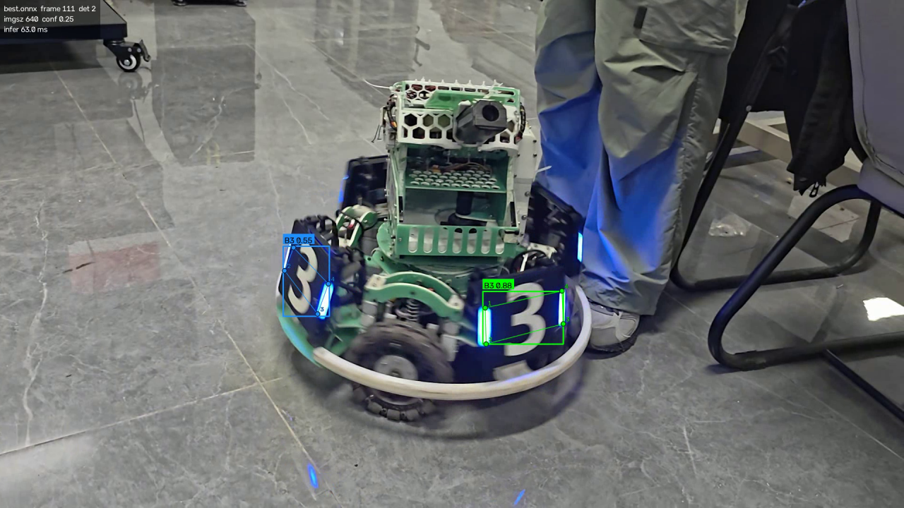
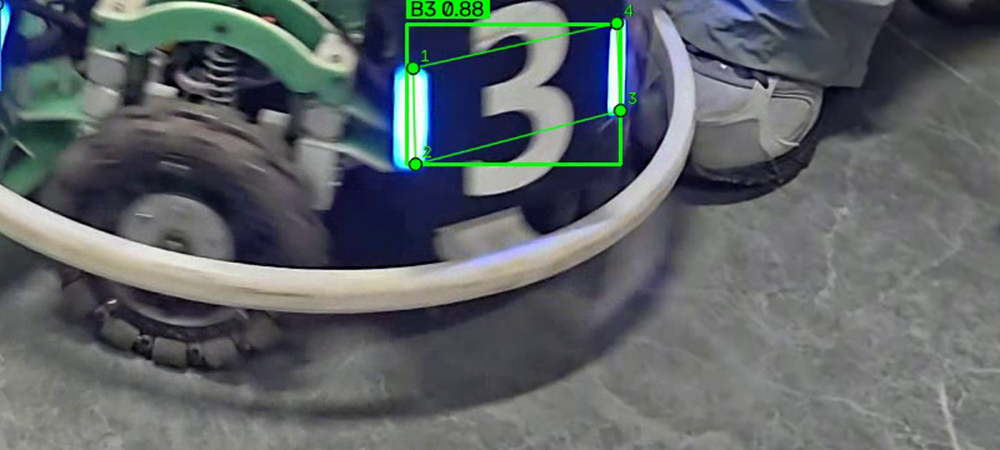

# YOLO 模型导出、推理与性能对比

把上一份作业的 RoboMaster 装甲板模型（YOLO26n-pose，`.pt`）导出为 **ONNX** 与 **TorchScript**，
用**同一套推理代码、同一段视频、同一组阈值**跑推理，再在**同一台机器**上量化对比
模型大小、加载耗时、推理耗时与检测结果。

- 详细数据与分析：[`comparison.md`](comparison.md)
- 一句话结论：**ONNX 在 CPU 上比 PyTorch 快 1.67×，且结果零损失；TorchScript 反而慢 20%。**

---

## 1. 本次使用的 YOLO 模型版本

| 项 | 值 |
| --- | --- |
| 模型 | `YOLO26n-pose`（上一份作业训练好的装甲板权重 `best.pt`） |
| 规模 | 2,704,788 参数（融合后 2,447,934），5.6 GFLOPs，129 层 |
| 任务 | `pose`（检测框 + 4 关键点） |
| 类别 | `{0: B1, 1: B2, 2: B3, 3: R1, 4: R2, 5: R3}` |
| 关键点 | `kpt_shape=[4, 2]`，即 4 个点、只有 (x, y)、无关键点置信度 |
| 推理框架 | ultralytics **8.4.188** |
| 原始权重 | `models/best.pt`（5.62 MB，已入库） |

模型元数据可以随时用下面这条命令复核：

```bash
python -c "from ultralytics import YOLO; m=YOLO('models/best.pt'); print(m.task, m.names, m.model.kpt_shape)"
# → pose {0: 'B1', 1: 'B2', 2: 'B3', 3: 'R1', 4: 'R2', 5: 'R3'} [4, 2]
```

## 2. 导出的模型格式与导出方法

导出脚本：[`export.py`](export.py)（同时支持 onnx / torchscript / engine / openvino 等 ultralytics 格式）

```bash
python export.py --weights models/best.pt --formats onnx torchscript --imgsz 640 --opset 12
```

| 格式 | 产物 | 大小 | 导出耗时 | 关键参数 |
| --- | --- | --- | --- | --- |
| ONNX | `models/best.onnx` | 9.72 MB | 2.79 s | `opset=12`，`simplify=True`（onnxslim 简化），静态 batch/尺寸 |
| TorchScript | `models/best.torchscript` | 9.95 MB | 0.77 s | `torch.jit.trace` 轨迹图 |

导出结果的自查（`export.py` 会写进 `results/export_report.json`）：

```
输入：images[1, 3, 640, 640]
输出：output0[1, 18, 8400]      # 18 = 4(框) + 6(类别) + 4×2(关键点)
ONNX 图：397 个节点，241 个初始化张量，opset ai.onnx=12
```

> 为什么体积反而变大？三个格式都是 fp32 精度，变大是因为 `.pt` 是 zip 压缩存储（5.89 MB），
> 而 ONNX/TorchScript 默认不压缩，文件大小≈权重原始字节数（约 10 MB）。

## 3. 运行环境与依赖库

| 项 | 值 |
| --- | --- |
| 操作系统 | Windows 11 |
| CPU | Intel Core 7 245HX（14 线程，基准固定 8 线程） |
| GPU | NVIDIA RTX 5060 Laptop（sm_120），仅用于附加测试 |
| Python | 3.13.14 |
| torch / torchvision | 2.14.1+cu130 / 0.29.1+cu130（CPU 推理为主） |
| ultralytics | 8.4.188 |
| onnx / onnxslim / onnxruntime | 1.23.2 / 0.1.98 / 1.31.1（`CPUExecutionProvider`） |
| opencv-python / numpy | 5.0.0 / 2.5.2 |

安装：

```bash
python -m venv .venv
.venv\Scripts\activate
pip install torch torchvision --index-url https://download.pytorch.org/whl/cu130   # 或 /cpu
pip install -r requirements.txt
```

## 4. 模型推理的具体运行命令

推理脚本 [`inference.py`](inference.py) 用 `--model` 切换格式，其余参数、绘制逻辑、统计口径完全一致：

```bash
# 原始 PyTorch 权重
python inference.py --model models/best.pt         --source assets/d414.mp4 --output results/best_pt_result.mp4

# ONNX
python inference.py --model models/best.onnx       --source assets/d414.mp4 --output results/best_onnx_result.mp4

# TorchScript
python inference.py --model models/best.torchscript --source assets/d414.mp4 --output results/best_torchscript_result.mp4
```

性能与一致性对比（预热 + 多轮重测，会自动生成 `results/benchmark.json` / `benchmark.md`）：

```bash
python benchmark.py --models models/best.pt models/best.onnx models/best.torchscript \
                    --frames 120 --repeats 3 --warmup 10 --threads 8
```

分析脚本（定位差异来源，详见 `comparison.md` §5）：

```bash
python tools/forward_bench.py        # 纯前向 vs 含前后处理，拆解框架开销
python tools/compare_raw_output.py   # 同一输入张量下三个后端的原始输出差异
python tools/compare_preprocess.py   # 三个后端实际喂进网络的输入张量形状
```

常用参数：`--device 0`（GPU）、`--imgsz 640`、`--conf 0.25`、`--iou 0.7`、
`--rect`（允许 stride 对齐的最小填充，默认关闭以保证各格式输入一致）、`--max-frames N`。

## 5. 原始模型与导出模型的推理结果截图

同一帧（第 111 帧），ONNX 结果（三个格式的检出完全一致）：



关键点细节（检测框 + 类别 + 置信度 + 4 个编号关键点）：



**输入尺寸陷阱的直观证据**（左：`.pt` 默认 `rect=True`，384×640 输入，多检出左上角 `B1 0.28`；
右：ONNX，640×640 输入，该处无检出）：


> 结果视频（`results/*_result.mp4`）体积较大未入库，按 §4 的命令即可重新生成；
> 三种格式在统一输入尺寸下逐目标一致（IoU=1.0），肉眼看不出差别。

## 6. 模型大小、推理耗时及检测效果对比

CPU、8 线程、120 帧、`imgsz=640`、统一 **640×640** 方形输入、预热 10 帧后 3 轮取平均：

| 模型格式 | 文件大小 | 加载耗时 | 推理耗时 | 吞吐 | 检测数量 | 检测效果 |
| --- | --- | --- | --- | --- | --- | --- |
| PyTorch `.pt` | 5.62 MB | 93.3 ms | 60.79 ms/帧 | 16.45 FPS | 173 | 基准 |
| **ONNX `.onnx`** | 9.72 MB | **4.4 ms** | **36.46 ms/帧** | **27.43 FPS** | 173 | 与 .pt 完全一致 |
| TorchScript `.torchscript` | 9.95 MB | 30.7 ms | 72.87 ms/帧 | 13.72 FPS | 173 | 与 .pt 完全一致 |

全片 264 帧的一致性核验：ONNX / TorchScript 相对 `.pt` 的 **IoU 均值 = 1.0、未匹配框 0 个、
类别翻转 0 次、关键点差 0.0 px、置信度差 0.0**，三种格式都是 378 个目标（B2 70、B3 308）。

完整表格、每轮明细、GPU 附加数据与原因分析见 [`comparison.md`](comparison.md)。

## 7. 实验过程中遇到的问题及解决方法

| 序号 | 问题现象 | 原因 | 解决方法 |
| --- | --- | --- | --- |
| 1 | 导出的模型比 `.pt` 大 1.7 倍 | `.pt` 是 zip 压缩存储，ONNX/TorchScript 不压缩；精度没变 | 无需处理，只需知道"体积大 ≠ 精度高" |
| 2 | 一开始对比得出"导出后掉精度、PyTorch 更快"的错误结论 | `.pt` 默认 `rect=True`（stride 对齐）→ 输入 384×640；静态图只能 640×640，**两者实际输入不同** | 统一 `rect=False` 强制方形输入后，三种格式结果完全一致、速度排名也反转 |
| 3 | 同一配置多次测出的耗时波动很大（ONNX 74 ms vs 104 ms） | ultralytics 会改动 torch 线程数；未固定线程时 ORT 在 14 核混合架构上线程争抢 | `benchmark.py --threads 8` 同时固定 torch 与 `OMP_NUM_THREADS`，并跑两遍复测（偏差 <1.5 ms） |
| 4 | 端到端 ONNX 起初比 PyTorch 还慢 | 非 torch 后端的解码/NMS 走 numpy 实现，`predict` 里有约 +44 ms 框架开销 | 用 `tools/forward_bench.py` 拆开计时定位；纯前向 ONNX 其实最快（32.7 ms vs 41.9 ms） |
| 5 | 在受控环境里 `pip install` 反复失败（`PermissionError`，临时目录进不去） | 以"仅所有者"权限模式创建的临时目录权限损坏，pip 解包目录不可写 | 把 `TEMP`/`TMP` 指到可写目录，并用 `sitecustomize.py` 放宽 `os.mkdir`/`os.open` 的权限位 |
| 6 | GPU 只有两种格式可比 | 安装的 `onnxruntime` 只有 `CPUExecutionProvider`；GPU 版需 `onnxruntime-gpu` 且 CUDA 版本对齐 | 明确标注 GPU 只测 torch 系格式；主表全部在 CPU 上完成，保证同硬件可比 |

## 8. 对不同模型格式的理解与实验结论

**三种格式到底差在哪**（细节见 `comparison.md` §5）：

| 维度 | PyTorch `.pt` | ONNX | TorchScript |
| --- | --- | --- | --- |
| 本质 | Python 序列化的模型对象（含训练元数据） | 与框架无关的计算图（protobuf + opset 版本） | PyTorch 自己的轨迹图（绑定 torch 版本） |
| 运行依赖 | ultralytics + torch | onnxruntime（C++/C#/Java/JS/移动端都有） | libtorch（C++） |
| 跨语言部署 | 差 | **最好** | 一般 |
| 图优化 | eager 逐算子执行（仅 Conv+BN 融合） | **ORT_ENABLE_ALL 融合/常量折叠/内核选择** | 只记录算子序列，无额外优化 |
| CPU 速度 | 60.79 ms | **36.46 ms** | 72.87 ms |
| 适合 | 训练、调试、快速验证 | **生产部署** | 已有 libtorch 工程 |

**结论**：

1. **导出是无损的**：统一输入尺寸后，ONNX / TorchScript 与 `.pt` 逐目标一致（IoU=1.0，关键点 0 px 差）。
   之前的"掉精度"是输入尺寸不一致造成的假象。
2. **ONNX 是这个模型在 CPU 上的最优选择**：快 1.67×，加载快 20 倍，还能脱离 Python 生态部署。
3. **TorchScript 不等于更快**：它解决的是"不依赖 Python"，不是性能；trace 出来的图不会做 Conv+BN 融合，
   实测比 eager 慢约 20%。
4. **对比实验的第一原则是"对齐输入"**：同一个 `imgsz` 参数在不同后端可能对应不同张量形状
   （384×640 vs 640×640，相差 40% 像素），不对齐就没有可比性。
5. **小模型上 GPU 收益有限**：5.6 GFLOPs 的模型，GPU（RTX 5060）只比 CPU 快约 3×，
   因为端到端时间被预处理、后处理、数据搬运摊薄——边缘部署时"ONNX + CPU"经常更划算。

---

## 目录结构

```
YOLO-Export-Inference/
├── README.md                # 本文件
├── requirements.txt         # 依赖
├── .gitignore
├── comparison.md            # 完整对比数据与原因分析
├── export.py                # 模型导出（onnx / torchscript / ...）
├── inference.py             # 多格式推理 + 可视化（结果视频 + 统计报告）
├── benchmark.py             # 多格式性能基准（预热 + 多轮 + 一致性校验）
├── tools/
│   ├── forward_bench.py     # 纯前向 vs 含前后处理，拆解框架开销
│   ├── compare_raw_output.py    # 同一输入下三后端原始输出对比
│   └── compare_preprocess.py    # 三后端实际输入张量形状对比
├── models/                  # 已入库：best.pt / best.onnx / best.torchscript
├── results/                 # 已入库：report/benchmark 的 json 与 md；mp4 视频不入库
├── docs/                    # 已入库：结果截图
└── assets/                  # 测试视频（不入库，需自行放入 d414.mp4）
```

## 复现步骤

```bash
git clone <本仓库地址> && cd YOLO-Export-Inference
python -m venv .venv && .venv\Scripts\activate
pip install -r requirements.txt

# 1) 导出（models/ 里已含导出产物，可跳过；重跑会覆盖）
python export.py --weights models/best.pt --formats onnx torchscript --imgsz 640 --opset 12

# 2) 准备测试视频（与上一份作业同一段 D414 视频，未入库）
#    assets/d414.mp4

# 3) 三种格式推理，输出结果视频与统计
python inference.py --model models/best.pt
python inference.py --model models/best.onnx
python inference.py --model models/best.torchscript

# 4) 性能对比（生成 results/benchmark.json 与 benchmark.md）
python benchmark.py --threads 8 --frames 120 --repeats 3
```

模型文件已直接入库（`.pt` 5.62 MB、`.onnx` 9.72 MB、`.torchscript` 9.95 MB，单个均远小于
GitHub 100 MB 限制），因此**不需要 Git LFS**，克隆后即可离线复现。
