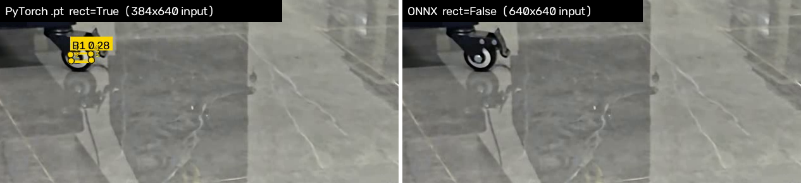

# 模型格式对比报告

> 全部数据在同一台机器、同一批帧、同一输入尺寸、同一阈值下测得。
> 原始记录：`results/export_report.json`、`results/benchmark.json`、`results/benchmark_full.json`、`results/benchmark_gpu.json`、`results/*_report.json`

## 1. 导出结果

| 格式 | 文件 | 大小 | 相对 .pt | 导出耗时 | 说明 |
| --- | --- | --- | --- | --- | --- |
| PyTorch | `models/best.pt` | 5.62 MB | 1.00× | — | 原始权重（zip 压缩存储） |
| ONNX | `models/best.onnx` | 9.72 MB | 1.73× | 2.79 s | opset 12，onnxslim 简化后 397 个节点 / 241 个初始化张量 |
| TorchScript | `models/best.torchscript` | 9.95 MB | 1.77× | 0.77 s | torch.jit.trace 轨迹图 |

- 三个格式的输入/输出一致：输入 `images[1, 3, 640, 640]`，输出 `output0[1, 18, 8400]`
  （18 = 4 个框参数 + 6 个类别分数 + 4 个关键点的 x/y）。
- 模型规模：2,704,788 参数（融合后 2,447,934），5.6 GFLOPs。

**为什么导出后反而变大？** 不是因为精度变了（三个格式都是 fp32）：
`.pt` 内部是 zip 压缩存储（5.89 MB / 原始约 10.8 MB），而 ONNX / TorchScript 默认不压缩，
文件大小≈权重的原始字节数。代价换来好处：ONNX 加载只要 4.4 ms，`.pt` 要 93.3 ms——
因为 `.pt` 还要反序列化 pickle、重建 Python 模型对象。

## 2. 性能对比（CPU，主表）

- 设备：Intel Core 7 245HX，固定 **8 线程**（`--threads 8`）
- 数据：`assets/d414.mp4` 前 **120 帧**（一次性解码到内存，重复使用）
- 参数：`imgsz=640`，`conf=0.25`，`iou=0.7`，`rect=False`（三种格式都补成 **640×640** 方形输入）
- 计时：预热 10 帧后重复 **3 轮**取平均，只计 `model.predict()`，不含读视频与绘制
- 复测：整个基准跑了两遍，均值偏差 < 1.5 ms（见 `benchmark.json` / `benchmark_run2.json`）

| 模型格式 | 文件大小 | 加载耗时 | 推理耗时（均值） | 吞吐 | 检测目标数量（120 帧） | 检测效果 |
| --- | --- | --- | --- | --- | --- | --- |
| PyTorch `.pt` | 5.62 MB | 93.3 ms | 60.79 ms/帧 | 16.45 FPS | 173 | 基准 |
| ONNX `.onnx` | 9.72 MB | 4.4 ms | **36.46 ms/帧** | **27.43 FPS** | 173 | 与 .pt 完全一致 |
| TorchScript `.torchscript` | 9.95 MB | 30.7 ms | 72.87 ms/帧 | 13.72 FPS | 173 | 与 .pt 完全一致 |

每轮明细（ms/帧）：

| 格式 | 第 1 轮 | 第 2 轮 | 第 3 轮 |
| --- | --- | --- | --- |
| PyTorch | 60.56 | 60.61 | 61.22 |
| ONNX | 36.71 | 36.48 | 36.20 |
| TorchScript | 72.42 | 72.92 | 73.26 |

**ONNX 比 PyTorch 快 1.67×，TorchScript 反而慢 1.20×。**

## 3. 检测结果一致性（全片 264 帧，rect=False）

| 对比 | IoU 均值 | 未匹配框 | 类别翻转 | 关键点差（均值/最大） | 置信度差（均值/最大） | 框数不一致帧 |
| --- | --- | --- | --- | --- | --- | --- |
| ONNX vs .pt | 1.00000 | 0 / 0 | 0 | 0.0 / 0.0 px | 0.0 / 0.0 | 0 |
| TorchScript vs .pt | 1.00000 | 0 / 0 | 0 | 0.0 / 0.0 px | 0.0 / 0.0 | 0 |

三种格式全片都是 **378 个目标**（B2 70、B3 308），逐帧逐目标一一对应。
即：**导出没有带来任何精度损失**（在 fp32、静态 640×640、相同阈值条件下）。

## 4. 一个容易踩的坑：同一个 `imgsz`，输入张量并不相同

ultralytics 对 `.pt` 默认 `rect=True`（stride 对齐的最小填充），对导出的**静态图**只能补成方形。
1920×1080 的画面在 `imgsz=640` 下：

| 后端 | 实际输入张量 | 像素量 |
| --- | --- | --- |
| `.pt`（`rect=True`，默认） | `(1, 3, 384, 640)` | 245,760 |
| ONNX / TorchScript（`rect=False` 等价的方形） | `(1, 3, 640, 640)` | 409,600 |

这既影响速度、也影响结果。同一段 120 帧、同一台机器：

| 配置 | 输入 | 推理耗时 | 吞吐 | 检出数量 | 类别分布 |
| --- | --- | --- | --- | --- | --- |
| `.pt` `rect=True`（默认） | 384×640 | 45.25 ms | 22.10 FPS | **178** | B1 5、B2 8、B3 165 |
| `.pt` `rect=False` | 640×640 | 60.79 ms | 16.45 FPS | 173 | B2 8、B3 165 |
| ONNX（方形） | 640×640 | 36.46 ms | 27.43 FPS | 173 | B2 8、B3 165 |

多出来的 5 个全是 **B1**——画面左上角那块面积很小、置信度只有 0.28 左右的远处装甲板。
方形填充多出的约 16 万像素改变了网络对这块小目标的响应，使它刚好越过 `conf=0.25`。

左：`.pt rect=True`（384×640）在左上角检出 `B1 0.28` 及 4 个关键点；右：ONNX（640×640）该处无检出。

**结论**：如果直接拿"`imgsz=640` 的 .pt"和"`imgsz=640` 的 onnx"对比，会误以为
"导出后精度下降、而且 PyTorch 更快"。实际上前者吃了小 40% 的输入。
本报告的 §2 全部强制 `rect=False`，才是可比的对比。

## 5. 原因分析

### 5.1 为什么 ONNX 更快

1. **图优化**：onnxruntime 以 `ORT_ENABLE_ALL` 做算子融合、常量折叠、内存复用，
   而 PyTorch eager 是逐算子解释执行（`.pt` 路径虽有 Conv+BN 融合，但没有跨算子优化）。
2. **CPU 算子库**：ORT 用 MLAS/oneDNN 的卷积实现，针对不同指令集（AVX2/AVX512/VNNI）选内核。
3. **输入形状固定**：静态 640×640 让内存分配与内核选择都能提前完成。
4. 反证：把同一张预处理好的张量直接喂给三个后端（见 `tools/forward_bench.py`），
   **纯前向** ONNX 32.7 ms、PyTorch 41.9 ms、TorchScript 51.4 ms——ONNX 的前向本身最快。
   端到端差距被 ultralytics 的后处理吃掉一部分（非 torch 后端用 numpy 解码/NMS，
   在 `predict` 里有约 +44 ms 的框架开销），所以真正部署时若自己写解码，ONNX 的优势会更大。

### 5.2 为什么 TorchScript 反而更慢

`torch.jit.trace` 得到的是"记录下来的算子序列"，它**不会再做 Conv+BN 融合**，
也没有 ORT 那种跨算子优化；再加上 jit 运行时的调度开销，实测比 eager 慢约 20%。
（用 `torch.jit.freeze` + `optimize_for_inference` 可以改善，但那是另一条优化路径，不属于单纯"导出"。）

### 5.3 为什么三个格式结果完全相同

`tools/compare_raw_output.py` 把**同一张输入张量**分别喂给三个后端：

| 对比 | 框 4 行最大差 | 类别 6 行最大差 | 关键点 8 行最大差 |
| --- | --- | --- | --- |
| `.pt` vs TorchScript | 0.000e+00 | 0.000e+00 | 0.000e+00 |
| `.pt` vs ONNX | 4.883e-04 | 1.550e-06 | 2.747e-04 |

TorchScript 与 PyTorch **逐元素完全相同**；ONNX 只有 1e-6~1e-4 的浮点差（算子实现顺序不同），
远小于检测阈值的影响，因此端到端结果一致。

### 5.4 各格式的定位差异

| 维度 | PyTorch `.pt` | ONNX `.onnx` | TorchScript `.torchscript` |
| --- | --- | --- | --- |
| 运行依赖 | ultralytics + torch（Python） | onnxruntime（Python/C++/C#/Java/JS/移动端） | libtorch（C++） |
| 跨框架 | 否 | **是**（标准 ONNX，opset 版本化） | 否（绑定 PyTorch 版本） |
| 文件大小 | 5.62 MB（压缩） | 9.72 MB | 9.95 MB |
| 加载耗时 | 93.3 ms | **4.4 ms** | 30.7 ms |
| CPU 端到端 | 60.79 ms | **36.46 ms** | 72.87 ms |
| 改动模型结构 | — | 需重新导出 | 不支持动态控制流（trace 只能记录走过的分支） |
| 适合场景 | 训练/调试/快速验证 | **生产部署（首选）** | 已有 libtorch 工程、且不想引入 ORT |

## 6. GPU 附加观察

本机是 RTX 5060 Laptop（sm_120），`torch 2.14.1+cu130` 可用；
但安装的 `onnxruntime 1.31.1` 只有 `CPUExecutionProvider`（GPU 版需要 `onnxruntime-gpu`
且 CUDA 版本要对齐），因此 GPU 只测了两种 torch 系格式（120 帧，`rect=False`）：

| 格式 | 设备 | 推理耗时 | 吞吐 |
| --- | --- | --- | --- |
| PyTorch `.pt` | CPU（8 线程） | 60.79 ms | 16.45 FPS |
| PyTorch `.pt` | **GPU** | **19.28 ms** | **51.87 FPS** |
| TorchScript | CPU | 72.87 ms | 13.72 FPS |
| TorchScript | **GPU** | **15.46 ms** | **64.69 FPS** |

有意思的是 GPU 只快了约 3×（而不是几十倍）：这个模型只有 5.6 GFLOPs，
单帧的预处理（letterbox）、后处理（解码+NMS）和数据搬运占比很大，
GPU 加速的是卷积部分，端到端就被这些固定开销摊薄了。
这也解释了为什么小模型在边缘设备上"ONNX + CPU"经常是更划算的选择。

## 7. 结论

1. **导出无损**：在相同输入尺寸、相同阈值下，ONNX / TorchScript 与 `.pt` 的检测结果逐目标一致
   （IoU=1.0，关键点差 0 px），导出本身不掉精度。
2. **CPU 上 ONNX 最优**：36.46 ms/帧（27.4 FPS），比 PyTorch 快 1.67×，加载还快 20 倍。
3. **TorchScript 不是"更快的 PyTorch"**：它只解决"脱离 Python 运行"，不解决性能；
   盲目换 TorchScript 反而会慢 20%。
4. **对比实验必须先对齐输入**：同一个 `imgsz` 在不同后端可能对应不同大小的输入张量
   （384×640 vs 640×640），不对齐就会得出"导出掉精度、PyTorch 更快"的错误结论。
   这是本次实验最大的收获。
5. **部署建议**：训练调试用 `.pt`；上线优先导出 ONNX（配合 onnxruntime，可按需切 GPU EP）；
   只有在已经使用 libtorch 的 C++ 工程里才考虑 TorchScript。
